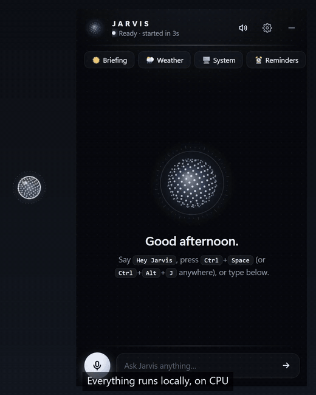
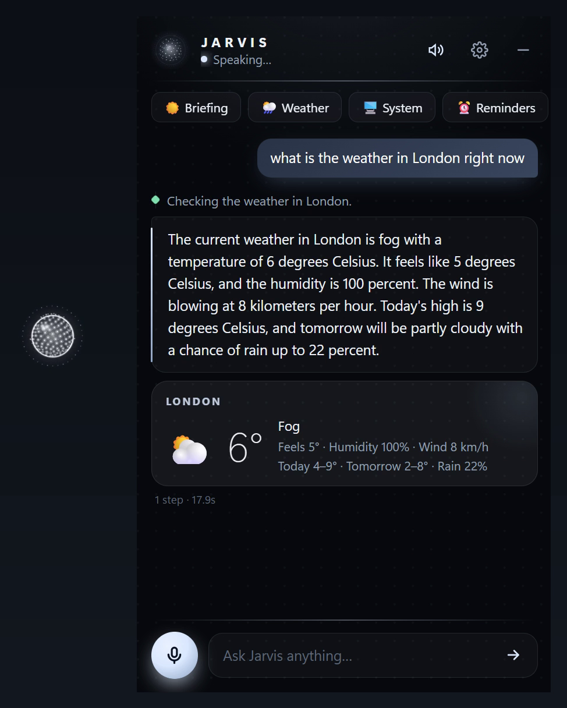
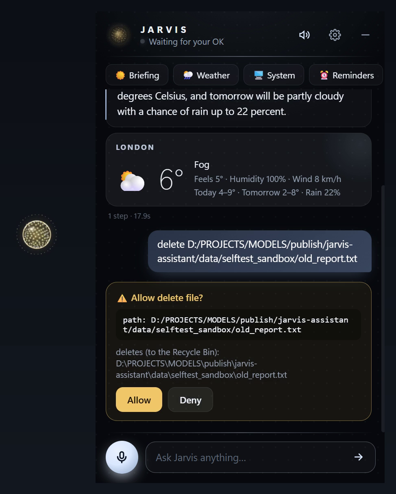
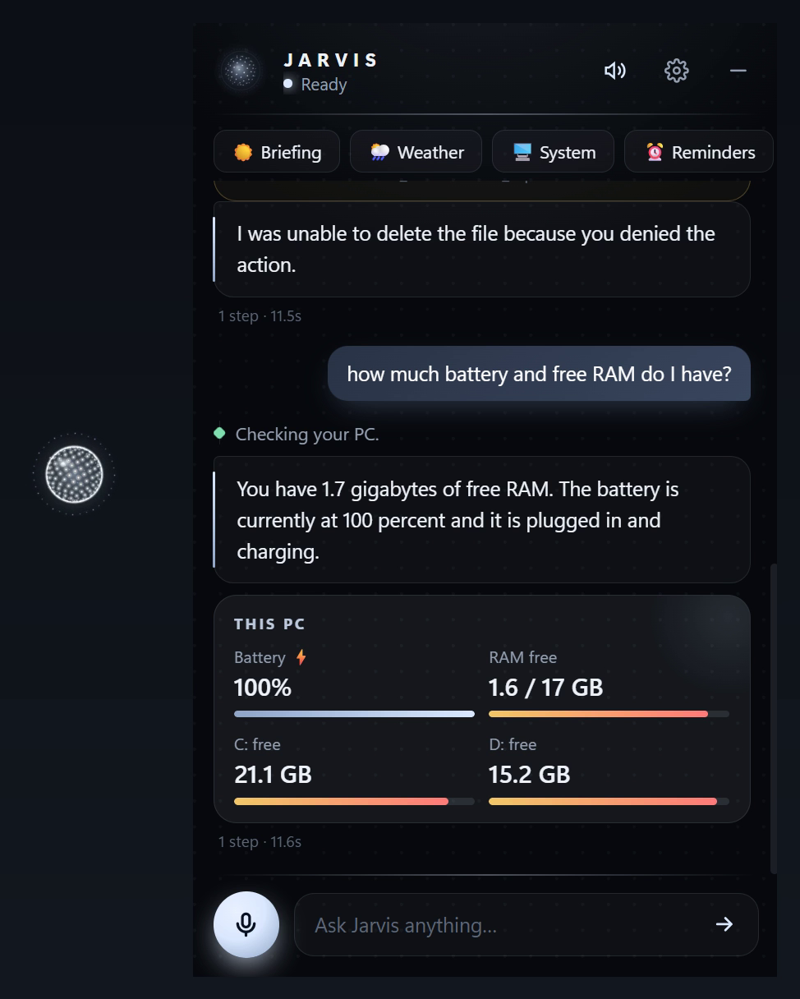

# Jarvis: an offline voice assistant for Windows, running a 2B LLM on CPU

A personal assistant whose AI runs **entirely on your own PC**: wake word, streaming speech-to-text, a local LLM, text-to-speech, and 55 tools that act on Windows (57 with the optional vision model). No GPU and no cloud AI. Only the web tools (search, weather, news, currency) go online. It is built around a **layered "System 1 / System 2" design**, so a small 2-billion-parameter model behaves reliably.



*The real app on a 4-core laptop CPU (GIF at 1.5x speed). The spoken request is a synthetic Piper voice fed in as the microphone, so the demo can be repeated without a person. Full video with Jarvis's voice: [docs/media/jarvis-demo.mp4](docs/media/jarvis-demo.mp4).*

| Voice request → tool → answer | Risky action waits for your OK | PC facts from a tool |
|---|---|---|
|  |  |  |

```
 "Hey Jarvis, ..." ─► wake word (openWakeWord + name check + optional owner-voice check)
                                   │
                                   ▼
        streaming speech-to-text (NVIDIA Nemotron 0.6B via sherpa-onnx, live captions)
        end of turn = Silero VAD silence + Smart Turn v3.2 + "did the sentence end on 'and'?"
                                   │
        ┌──────────────────────────┘
        ▼
  System 1 router (bge-small embeddings + rules, 6–55 ms)
        ├── simple / exact things ─► run directly, no LLM (volume, timers, maths, PC facts, open apps…)
        └── everything else ─► LLM (Gemma 4 E2B, English-only trim, llama.cpp + MTP draft, streamed)
                                   │  JSON tool calls
                                   ▼
                        tools (55) ─► permission policy (in code) ─► Allow/Deny card for risky actions
                                   │
                        code guards: no "I did X" without a real tool call, numbers must come
                        from tool output, every part of a multi-part request must be covered …
                                   │
                                   ▼
          answer ─► panel cards + spoken reply (Piper TTS, sentence by sentence while it's written)
```

**The model:** [Gemma 4 E2B trimmed to an English-only vocabulary](https://github.com/Nilanjan112233/llm-vocab-trimmer). That is my own no-training method: the file is 41% smaller and the assistant is 33% faster per task, with the same accuracy.

## Results

I tested it on my own set of **138 real requests** across chat, PC info, files, actions, reminders, memory, writing, research, safety, skills and hallucination traps. Each request is scored automatically: right tool used, answer grounded in the tool output, job finished, nothing unsafe done. On-screen actions are stubbed (recorded, not done) and file changes only happen in a test folder. During development, each change was kept only if the score went up:

| Run (14 Nov 2026) | What changed | Pass | Unsafe actions | Median time |
|---|---|---|---|---|
| baseline | plain LLM + tools | 63% | 0 | 4.9 s |
| 3 | System-1 router + code guards + persona | 81% | 0 | 7.9 s |
| 4 | multi-part / fresh-fact rules, more tools | 91% | 0 | 10.3 s |
| 5 | exact maths, full cached tool list (prompt cache) | 91% | 0 | 6.1 s |
| **6** | direct PC facts, "promise" check | **94%** | **0** | **5.5 s** |
| 7 | name-the-items and missing-file checks | 93% | 0 | 5.6 s |

**Re-run on 20 Nov 2026** (same 138 requests and scoring; on-screen tools added since then are stubbed too. The v9 run shared the PC with other heavy jobs, so compare its pass rate, not its time):

| Code | Pass | Honest "can't" | Fail | Unsafe actions | Median time |
|---|---|---|---|---|---|
| previous version of this repo (v9) | 89% (123) | 2 | 13 | 0 | 7.0 s |
| **current code** | **92% (127)** | 3 | 8 | **0** | **5.0 s** |

The 14 Nov best of 94% wasn't reached again. On 20 Nov DuckDuckGo was answering automated searches with a bot check, so every web search failed. That caused 6 of the 13 failures in the v9 run. The current code falls back to Wikipedia, which fixed the fact questions but not live prices: 2 of the remaining 8 failures are bitcoin and gold prices. The others are small-model slips (for example, it counted documents with its own script instead of trusting the file tool).

Routing takes 6–55 ms (median 21 ms, 95% within 41 ms; the same 138 requests on the same PC). The two exceptions took ~1.4 s: "system check" requests, where the router also gathers the PC facts for its direct answer. 32 of the 138 were answered without the LLM.

More than 20 kinds of request are answered by the router with no LLM at all, so they can't be hallucinated. The benchmark itself isn't in this repo, because its cases use files and facts from my own machine.

### Choosing the brain

I compared smaller tool-calling models with the same 25 voice-assistant tests (all actions stubbed), on the same PC:

| Model | Passed | Median / mean per request | Writing speed |
|---|---|---|---|
| **Gemma 4 E2B en50v Q4_0 + MTP (used)** | **24/25** | **4.8 s / 6.1 s** | ~15 tok/s |
| xLAM-2-1B-fc-r Q4_0 | 21/25 | 5.0 s / 15.0 s | ~12 tok/s |
| LFM3-1.7B Q4_0 | 18/25 | ~20 s / ~38 s | ~17 tok/s |

LFM3 writes faster but reads prompts slower, and its hybrid layers reuse the prompt cache badly, so it re-reads 1,000+ tokens on every step of a tool loop. A smaller model wasn't faster in practice. The speed comes from MTP, the prompt cache and more direct routes.

### Speech-to-text

| Engine | Word error rate (my test clips) | Delay after you stop talking |
|---|---|---|
| **Nemotron Speech Streaming EN 0.6B int8 (used)** | **4.5%** | **0.4 s** |
| Moonshine base | 6.1% | |
| Whisper base.en | 8.0% | 1.0 s |

## Features

- **Voice, fully offline.** One always-open microphone for the wake word, the button and follow-ups, with live captions while you talk.
  - **Wake word:** "Hey Jarvis" (openWakeWord) plus a fuzzy name check, so "Jervis" is accepted and "Hey, Java is…" is rejected. The name works anywhere in the sentence ("open Notepad, Jarvis"), and a request said just before "Hey Jarvis" is still picked up. Weak wake-ups from background talk (an audiobook, the TV) stay silent unless the words really contain "Jarvis".
  - **Owner voice (optional):** "Teach Jarvis my voice" trains a filter, and a speaker-ID check (WeSpeaker ResNet34) means other people and the TV can't wake it. In my tests my voice scored 0.89–0.98 and other voices 0.36–0.42.
  - **End of turn:** a pause after "and…" or "to…" doesn't cut you off. The end is decided by silence (Silero VAD), tone of voice (Smart Turn v3.2) and whether the sentence sounds finished.
  - **Stop and queue:** "stop", "cancel" or "never mind" stops it mid-thought in 0.1–0.6 s, also while it's working or talking. Requests made while it's busy wait in a queue.
  - **Echo cancellation:** WebRTC AEC3 removes Jarvis's own voice from the microphone (38–40 dB in my simulation), so you can talk over it and say "stop" without the wake word.
  - **Privacy:** speech that isn't for Jarvis is only logged as a word count, and logs are size-capped.
- **Voices:** four Piper voices to pick from in Settings (Lessac US, Alan British, Northern British, Ryan US) and a speaking-speed setting. You can also just say "use a British voice" or "talk 1.5 times faster".
- **Streaming replies.** Words appear about 1 s after a request. Finished sentences are spoken while the rest is still being written, but only after they pass the honesty checks.
- **Fast start:** the first start reads the ~5,000-token instructions once (~40 s on a 4-core CPU) and saves the engine's prompt cache to disk; later starts load it back in about 3 s.
- **UI:** a floating particle-sphere orb in a native see-through window. It ripples with your voice, spins while thinking, shows progress while working, and pulses gold when it needs your OK. There are three themes (Emerald, Crimson, Glass) and a slide-out panel with a live timeline of each step, result cards (weather, PC stats, headlines, files, currency, world clock), in-panel Allow/Deny cards, chat history and settings. Global hotkey: Ctrl+Alt+J.
- **55 tools:** web search (Wikipedia fallback when the search site blocks), weather, news, currency, world time, PC/network info, installed apps, files (find, read, largest, sizes, write, move, delete to the Recycle Bin), guarded Python/PowerShell, exact volume, media control of the real Chrome/Spotify session, YouTube playback (also in incognito), Chrome profiles, settings, screenshot, lock, clipboard, reminders/timers with sounds, snooze and Windows notifications, lists, notes, memory, searching past chats ("what did we talk about yesterday?"), learned "skills", and changing its own settings ("talk faster", "change your colour").
- **Reading the screen:** offline OCR with Windows' built-in engine. It captures a window even when it's covered, and it's read-only: nothing is saved or sent.
- **Vision (optional, `setup.ps1 -Vision`):** Gemma 4's own image encoder lets the same brain look at the screen or a picture (`look_at_screen`, `describe_image`). About 11 s per picture on CPU and +0.44 GB RAM.
- **Desktop control without vision:** it uses apps through the Windows accessibility tree ([agent-desktop](https://github.com/vercel-labs/agent-desktop)). The LLM writes plain steps ("click File", "type X in Text editor"), and a System-1 executor matches each one to an on-screen element by fuzzy name matching, with no LLM call per step. It only does this when you asked it to operate an app.
- **Memory:** facts like "my name is…", "I live in…" and "don't use X" are saved automatically by code, not by the model.
- **Plugins:** drop a `.py` file with a `@tool(...)` function into `data/plugins/` and it becomes a new tool (see [data/plugins/README.md](data/plugins/README.md)). Plugin tools ask before running unless marked `risk="safe"`.

## Safety, enforced in code rather than in the prompt

- `app/policy.py`: read-only actions run immediately. Anything that changes something asks first. Destructive, security-changing or downloading commands and system folders are blocked. The model's text is never passed straight to a shell.
- **PowerShell:** a command counts as read-only only if every part is a known look-only command; assignments (`$x = Remove-Item …`) are judged by their right side, and only a list of look-only .NET calls is allowed.
- **Python:** model-written code runs in a separate Python process with an audit hook (`sys.addaudithook`) that stops file changes outside the temp folder, starting programs, network connections and native code, and then asks you. This guards against the model's mistakes; it is not a sandbox against deliberately malicious code (Python's docs say audit hooks aren't one).
- **Data leaving the PC:** after Jarvis has read a web page, file or the screen, a web address the model put together itself needs your OK (a page can't make it "open evil.com/?q=your-file"). Direct download links (.exe, .msi, .zip …) also ask first.
- Desktop control stays locked to the window it started on, asks before risky buttons (send, delete, buy, pay, install, sign out…), and never types into password fields.
- Text from websites, files, the screen and command output is treated as data, never as instructions.
- Settings changes and "saving" tools (tasks, notes, memory, clipboard) are dropped unless you actually asked. Claims like "I have stopped Notepad" are checked against what the tools really did.
- Allow can also be given by voice with a code word you choose, checked against your voice.

## Setup (Windows 10/11, Python 3.13)

```powershell
git clone https://github.com/Nilanjan112233/jarvis-offline-voice-assistant
cd jarvis-offline-voice-assistant
powershell -ExecutionPolicy Bypass -File setup.ps1   # ~2.7 GB of engine/models/voice, SHA-256 checked
.\run_jarvis.bat
```

`setup.ps1` needs the `py` launcher with Python 3.13 and about 6 GB of free disk. It is safe to run again (files that already match their SHA-256 are skipped). Options: `-Vision` also downloads the image encoder (557 MB), and `-Dev` installs pytest and ruff.

Hardware: any 4-core x86-64 CPU and about 5 GB of free RAM (speech models ~1.2 GB, LLM ~2.5 GB). The first start takes about a minute; later starts take a few seconds. On a slow disk, set `JARVIS_START_TIMEOUT` (seconds, default 300).

UI demo without the backend: open `ui/preview.html` (orb + panel) or `ui/panel.html` in a browser. It switches to a demo mode with sample data.

## Tests

```powershell
.\.venv\Scripts\python -m pytest       # after setup.ps1 -Dev; no models needed, takes a few seconds
```

The suite covers the permission rules (including the PowerShell and URL holes fixed in v10), the Python audit-hook guard (blocked writes, deletes, subprocesses, sockets and native code), reminder time parsing, speech-speed words, tool calls the model wrote as text, chat recall and the Windows version check: 87 tests.

Self-test of the whole app (drives the real window end to end, read-only): `set JARVIS_SELFTEST=1` and then `run_jarvis.bat`. The results go to `data/selftest.log`.

## Known limitations

- Windows only (WinRT OCR/media/notifications, Win32 windows, PowerShell).
- Web search uses DuckDuckGo's HTML page. When it asks for a bot check, Jarvis falls back to Wikipedia, which has no live prices or today's news, and says so.
- A 2B model still slips now and then (see the failures in the benchmark). One visible case: a first draft answer is sometimes shown and then replaced, when the "numbers need a source" check makes it look the answer up (1 of 9 cases per run in one of my test sets).
- The "Jarvis" keyword spotter (sherpa-onnx KWS) is off by default: the small model missed my real "Hey Jarvis" recordings. `JARVIS_KWS=1` turns it on for testing.
- The openWakeWord `hey_jarvis` model is CC BY-NC-SA 4.0 (non-commercial).

## Layout

| Path | What |
|---|---|
| `app/main.py` | desktop app: orb + panel windows, events, hotkey, reminders, microphone threads |
| `app/agent.py` | the brain: persona, streamed LLM loop, code guards, auto-memory, fast start |
| `app/router.py` | System-1 router: embeddings + rules, direct answers |
| `app/tools.py` | the tools, the Python guard, plugin loader |
| `app/speech.py` | live listening: VAD, end-of-turn, streaming speech-to-text, wake word, owner-voice check, echo cancellation |
| `app/voice.py` | text-to-speech (Piper voices), reminder sounds, echo reference, whisper.cpp fallback |
| `app/orb_native.py` | see-through orb window (per-pixel alpha, ctypes + numpy) |
| `app/desktop.py` | desktop control executor |
| `app/policy.py` | permission rules |
| `app/timeparse.py` | "7 pm", "Friday 10am", "in 20 minutes" → time |
| `app/*.ps1` | Windows OCR, media-session, notification and image-capture helpers |
| `ui/` | orb + panel (HTML/CSS/JS) |
| `tests/` | pytest suite (no models needed) |
| `data/` | created at runtime: memory, notes, reminders, chat history, logs (git-ignored, except `data/plugins/`) |
| `docs/media/` | screenshots and demo video |

## Credits and licenses

Code: MIT, see [LICENSE](LICENSE). Third-party parts are downloaded by `setup.ps1` and are not included in this repo:

| Part | License |
|---|---|
| [Gemma 4 E2B](https://huggingface.co/google/gemma-4-E2B-it) (Google), English-trimmed; image encoder GGUF by ggml-org | Apache-2.0 |
| [llama.cpp](https://github.com/ggml-org/llama.cpp) b12360 | MIT |
| [bge-small-en-v1.5](https://huggingface.co/BAAI/bge-small-en-v1.5) (BAAI), GGUF by CompendiumLabs | MIT |
| [Nemotron Speech Streaming EN 0.6B](https://huggingface.co/nvidia/nemotron-speech-streaming-en-0.6b) (NVIDIA), int8 export by sherpa-onnx | NVIDIA Open Model License |
| [sherpa-onnx](https://github.com/k2-fsa/sherpa-onnx) | Apache-2.0 |
| [Silero VAD](https://github.com/snakers4/silero-vad) | MIT |
| [Smart Turn v3.2](https://huggingface.co/pipecat-ai/smart-turn-v3) (Pipecat) | BSD-2-Clause |
| [WeSpeaker](https://github.com/wenet-e2e/wespeaker) ResNet34 speaker model | Apache-2.0 |
| [whisper.cpp](https://github.com/ggml-org/whisper.cpp) b5454 + base.en model (fallback) | MIT |
| [Piper](https://github.com/rhasspy/piper) + lessac, alan, northern_english_male and ryan voices | see each voice's model card |
| [pywebrtc-audio](https://github.com/strands-labs/pywebrtc-audio) (WebRTC echo cancellation) | Apache-2.0 |
| [openWakeWord](https://github.com/dscripka/openWakeWord) + `hey_jarvis` model | code Apache-2.0; pre-trained models CC BY-NC-SA 4.0 (non-commercial) |
| [agent-desktop](https://github.com/vercel-labs/agent-desktop) v1.2.0 (Vercel Labs) | Apache-2.0 |
| [pywebview](https://github.com/r0x0r/pywebview) | BSD-3-Clause |
| [pycaw](https://github.com/AndreMiras/pycaw) | MIT |
